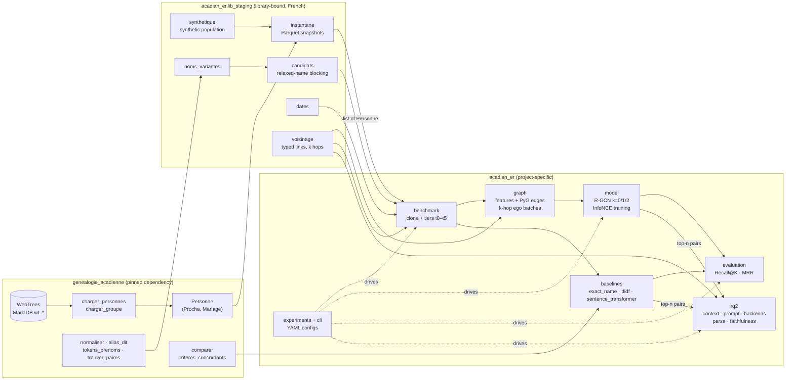

# Architecture

## Data flow

The boundary is one-way: `lib_staging` imports only `genealogie_acadienne` and light
libraries (pandas, pyarrow, numpy, stdlib). `tests/lib_staging/test_frontiere.py`
enforces this. Project code may import anything.

## The common currency: `list[Personne]`

Every stage passes `genealogie_acadienne.Personne` objects around. They come from:
- the database: `charger_groupe`, exported once by `lib_staging.instantane` into Parquet;
- or the synthetic generator: `lib_staging.synthetique.generer_population`.

Both produce the same objects, so the experiments cannot tell which source they got.
People are keyed by `(tree_id, person_id)` (`lib_staging.voisinage.Cle`). Relatives are
linked through `Proche.person_id` and `Mariage.conjoint_id`, which were added to the
library for this project.

## Modules and interfaces

| Module | Main interface |
| --- | --- |
| `lib_staging.instantane` | `ecrire_instantane(personnes, dossier, source)`, `lire_instantane(dossier) -> list[Personne]`, `instantane_depuis_base(conn, dossier)` |
| `lib_staging.synthetique` | `generer_population(graine, ...) -> PopulationSynthetique(personnes, identites)` |
| `lib_staging.candidats` | `IndexCandidats(population).candidats(p, arbres_exclus=...) -> list[Cle]` |
| `lib_staging.voisinage` | `liens_de(p)`, `tous_les_liens(index)`, `voisinage(cle, index, k)`, `proches_par_role(p, index)` |
| `lib_staging.noms_variantes` / `dates` | `cle_prenom`, `cle_nom_famille`, `cles_prenoms`; `analyser_date`, `decaler_date`, `ecart_annees` |
| `graph` | `build_graph(people, FeatureConfig) -> FamilyGraph` (PyG `Data(x, edge_index, edge_type)` + CSR); `ego_batch(graph, centres, k) -> EgoBatch` |
| `benchmark` | `build_benchmark(population, cfg) -> Benchmark(people, queries, anchors, clone_trees)`; `Query(tier, query, target, candidates, perturbation)` |
| `baselines` / `experiments.rq1.RGCNRanker` | `Ranker.score(query, candidates) -> np.ndarray` (higher = more likely the same) |
| `model` | `RGCNEncoder(in_dim, num_relations, k, ModelConfig)`; `train_encoder(graph, k, cfg, exclude)`; `embed(enc, graph, keys, cfg)` |
| `evaluation` | `rank_of_target(scores, candidates, target, query, seed)`; `summarise(per_query, ks)` |
| `rq2` | `build_context(a, b, index, k) -> PairContext`; `build_prompt(ctx)`; `LLMBackend.complete(system, user) -> str`; `parse_response(text) -> Verdict`; `check_faithfulness(evidence, ctx)`; `verification_metrics(rows)` |
| `experiments` | `stage_benchmark / stage_train / stage_evaluate / run_rq1`; `stage_candidates / stage_verify` |
| `cli` | `acadian-er <stage> --config <yaml>` |

## RQ1 pipeline

1. **Population**: a snapshot or synthetic data (`data.load_population`).
2. **Benchmark** (`benchmark.build_benchmark`): anchors are sampled among well-documented
   people. For each tier, each anchor plus its immediate family is cloned into tree
   `900 + tier`, and that tier's perturbation is applied to the clone. The query is the
   clone and the target is the original. Candidates come from the relaxed-name index
   over the original population and never include clone trees.
3. **Training** (`model.train_encoder`): one encoder per k, trained on the population
   without clones. Benchmark anchors are never used as training anchors.
4. **Ranking**: every method scores the same candidate list for every query. The R-GCN
   embeds queries in the graph that includes the clones, so a clone's neighbourhood is
   its cloned (perturbed) family.
5. **Evaluation**: rank of the target with seeded tie-breaking, then Recall@5,
   Recall@10 and MRR per tier and overall, plus candidate-list recall.

## RQ2 pipeline

1. `rq2-candidates`: sample real people, rank their candidates with an RQ1 method, and
   export the top-n pairs as JSONL with `label: null` for hand-labelling.
2. `rq2`: for each labelled pair and each k in {0, 2}:
   - build a context of facts with IDs;
   - prompt the backend (`fake`, `ollama` or `openai_compat`);
   - parse the reply into a verdict plus cited evidence;
   - check every citation against the context.
   Then compute the metrics.

## Outputs

`results/<config.name>/rq1/` and `results/<config.name>/rq2/` each hold `summary.csv`,
`report.md`, the per-item data (`per_query.csv` or `responses.jsonl`), `config.yaml`
and `manifest.json` (git commit, seed, timestamp). Checkpoints are in `rq1/checkpoints/`.
